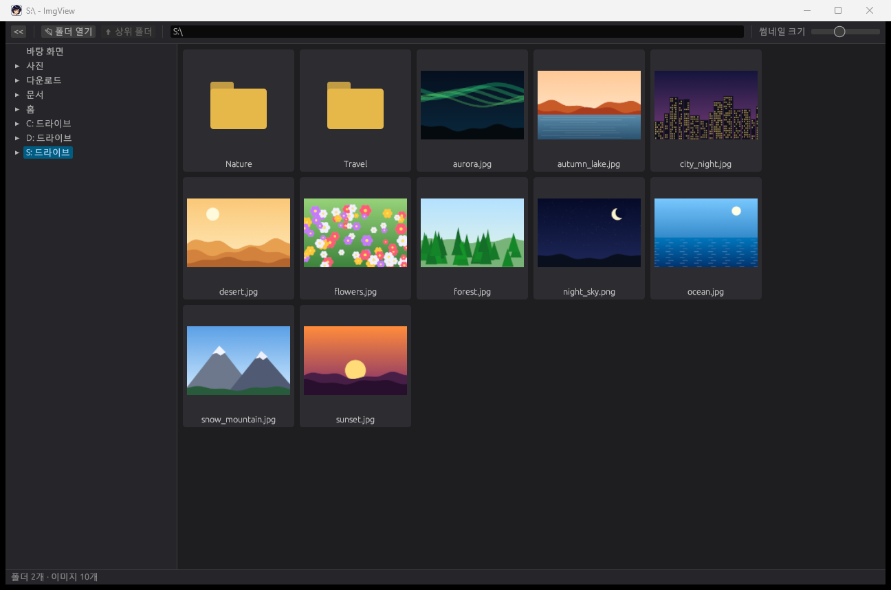

# ImgView

**한국어** | [English](#english)

ACDSee 스타일의 가볍고 빠른 이미지 뷰어입니다. Rust와 [egui](https://github.com/emilk/egui)로 만들었고 Windows, macOS, Linux에서 동작합니다.

왼쪽 폴더 트리에서 폴더를 고르면 오른쪽에 썸네일이 격자로 나오고, 썸네일을 더블클릭하면 크게 볼 수 있습니다.



## 주요 기능

- **폴더 트리 + 썸네일 목록**: 폴더를 고르면 이미지가 썸네일로 표시되고, `<<` 버튼으로 트리를 숨길 수 있습니다.
- **크게 보기**: 마우스 휠로 확대/축소, 끌어서 이동, ←/→로 이전/다음 이미지. GIF 애니메이션도 재생됩니다.
- **파일 관리**: 탐색기와 끌어놓기로 복사, Del로 휴지통 이동, Shift+Del로 영구 삭제, Ctrl/Shift+클릭으로 여러 개 선택
- **정렬**: 빈 곳을 오른쪽 클릭 → Sort by (Name / Date modified / Type / Size / Date created)
- **설정 기억**: 마지막 폴더, 정렬, 썸네일 크기, 창 위치를 다음 실행 때 그대로 복원합니다.
- **지원 형식**: PNG, JPG, GIF, BMP, ICO, TIFF, WebP, TGA, PNM(PBM/PGM/PPM), QOI, HDR
  — 사진의 EXIF 회전 정보를 반영하고, 확장자가 틀려도 파일 내용으로 형식을 판별합니다.
- **빠른 표시**: 썸네일은 화면에 보이는 것만 백그라운드에서 읽고, 크게 보기에서는 앞뒤 이미지를 미리 읽어 둡니다.

## 사용법

| 화면 | 동작 |
|---|---|
| 폴더 트리 | 폴더 클릭 → 오른쪽에 내용 표시 · `<<` / `>>` 버튼으로 숨기기/보이기 |
| 목록 | 클릭 → 선택 · 썸네일 더블클릭 → 크게 보기 · 폴더 타일 더블클릭 → 폴더 이동 |
| 목록 | Ctrl+클릭: 여러 개 선택 · Shift+클릭: 범위 선택 · Ctrl+A: 전체 선택 · Esc / 빈 곳 클릭: 선택 해제 |
| 목록 | **Del**: 선택한 항목을 휴지통으로 이동 · **Shift+Del**: 확인 후 영구 삭제 (휴지통을 거치지 않음) |
| 목록 | 빈 곳 오른쪽 클릭 → **Sort by** (Name / Date modified / Type / Size / Date created, Ascending / Descending), **Refresh** |
| 목록 | 방향키 이동, Enter 열기, Backspace 상위 폴더, Ctrl+O 폴더 열기, F5 새로 고침 |
| 목록 | 탐색기 → 창에 끌어다 놓기: 현재 폴더로 **복사** (같은 이름이 있으면 `이름 (2).jpg`로 저장) |
| 목록 | 썸네일 → 탐색기로 끌기: **복사** (선택한 파일 전부, Windows/macOS) |
| 크게 보기 | 휠: 확대/축소 (커서 위치 기준) · 왼쪽 버튼 끌기: 보이는 영역 이동 |
| 크게 보기 | ←/→, PageUp/PageDown: 이전/다음 · 0: 화면 맞춤 · 1: 100% · +/-: 확대/축소 · F11: 전체 화면 |
| 크게 보기 | Del / Shift+Del: 보고 있는 이미지 삭제 후 다음 이미지로 |
| 크게 보기 | Esc / Backspace / 더블클릭: 목록으로 |

## 빌드 / 실행

[Rust](https://rustup.rs)가 필요합니다 (OS별 설치 방법은 [아래](#rust-설치) 참고).

```sh
git clone https://github.com/KyleByun/imgviewer.git
cd imgviewer
cargo run --release                 # 실행
cargo run --release -- "D:\사진"     # 폴더나 이미지를 지정해서 실행
cargo test                          # 테스트
```

실행 파일은 `target/release/imgview(.exe)`에 만들어집니다. 폴더나 이미지를 실행 파일에 끌어다 놓아도 열립니다.

- **macOS**: `sh packaging/macos/build_app.sh` → `target/release/ImgView.app`을 응용 프로그램 폴더로 옮기면 Finder/Dock에 아이콘이 보입니다.
- **Linux**: `sh packaging/linux/install.sh` → 실행 파일, 아이콘, 앱 메뉴 항목을 사용자 폴더에 설치합니다.
  빌드에 필요한 패키지는 [Ubuntu 설치](#ubuntu)를 참고하세요.

## 아이콘

원본 그림은 `src/icon.png`이고, 둥근 사각형 바깥을 투명하게 만든 OS별 아이콘 파일이 `assets/icons/`에 있습니다.

| 파일 | OS | 적용되는 곳 | 방법 |
|---|---|---|---|
| `imgview.ico` (16~256px) | Windows | exe 파일, 바탕 화면·바로 가기, 탐색기, 작업 표시줄 | 빌드할 때 자동으로 exe에 들어감 (`build.rs`) |
| `imgview.icns` (16~1024px) | macOS | Finder, Dock, Launchpad | `packaging/macos/build_app.sh` |
| `imgview_256.png`, `imgview_512.png` | Linux | 앱 메뉴, 바탕 화면 | `packaging/linux/install.sh` |
| `imgview_256.png` | 공통 | 실행 중인 창의 제목 표시줄, 작업 표시줄/Dock | 빌드할 때 자동으로 실행 파일에 들어감 |

그림을 바꾸려면 `src/icon.png`를 교체하고 아이콘 파일을 다시 만든 뒤 빌드하세요.

```sh
cargo run --release --example make_icons   # src/icon.png → assets/icons/*
cargo build --release
```

Windows에서 바탕 화면 바로 가기가 예전 아이콘으로 보이면 아이콘 캐시를 새로 고치세요: `ie4uinit.exe -show`

## 설정 저장

마지막 폴더, Sort by 설정, 썸네일 크기, 폴더 트리 표시 여부, 창 크기·위치, 트리 너비와 펼침 상태를 기억합니다.
프로그램을 끌 때(그리고 실행 중 30초마다) 아래 파일에 저장됩니다. 파일을 지우면 처음 상태로 돌아갑니다.

- Windows: `%APPDATA%\ImgView\data\app.ron`
- macOS: `~/Library/Application Support/ImgView/app.ron`
- Linux: `~/.local/share/imgview/app.ron`

창 위치는 저장된 물리 픽셀 위치 그대로 복원하므로 배율이 다른 모니터가 섞여 있어도 밀리지 않고, 최대화한 창은 그 모니터에서 다시 최대화됩니다.
저장된 위치가 지금 화면 영역 밖이면(듀얼 모니터에서 모니터 하나를 뺀 경우 등) 가장 가까운 모니터의 가운데로 띄웁니다. (Windows. macOS는 OS가 알아서 화면 안으로 옮깁니다.)

## Rust 설치

어느 OS든 공식 설치 관리자인 **rustup**으로 설치합니다. 설치가 끝나면 **새 터미널 창**에서 확인하세요.

```sh
rustc --version
cargo --version
```

### Windows 11

PowerShell에서:

```powershell
# 1) C++ 빌드 도구 (Rust의 MSVC 링커와 아이콘 리소스 컴파일러가 필요로 함, 관리자 권한 필요)
winget install Microsoft.VisualStudio.2022.BuildTools --override "--wait --passive --add Microsoft.VisualStudio.Workload.VCTools --includeRecommended"

# 2) rustup (Rust 설치 관리자)
winget install Rustlang.Rustup
```

winget 대신 https://rustup.rs 에서 `rustup-init.exe`를 받아 실행해도 됩니다.

**빌드가 `os error 4551`로 막히면**: Windows 11의 Smart App Control이 빌드 중 생성되는 서명 없는 프로그램(build script)을 막은 것입니다.
Windows 보안 → 앱 및 브라우저 컨트롤 → Smart App Control 설정 → **끄기**

### Ubuntu

터미널에서:

```sh
# 1) 컴파일러/링커와, 창·폴더 선택 창(GTK)을 만드는 데 필요한 개발 패키지
sudo apt update
sudo apt install -y build-essential curl pkg-config \
    libgtk-3-dev libxkbcommon-dev libxcb-render0-dev libxcb-shape0-dev libxcb-xfixes0-dev

# 2) rustup (질문이 나오면 Enter = 기본 설치)
curl --proto '=https' --tlsv1.2 -sSf https://sh.rustup.rs | sh

# 3) 지금 터미널에 바로 적용 (새 터미널은 자동으로 적용됨)
. "$HOME/.cargo/env"
```

`apt install rustc cargo`로 설치하는 배포판 패키지는 버전이 오래되어 빌드가 안 될 수 있으니 rustup을 쓰세요.
다른 배포판(Fedora 등)에서는 같은 이름의 GTK3/xkbcommon/xcb 개발 패키지를 설치하면 됩니다. (Fedora: `sudo dnf install gcc gtk3-devel libxkbcommon-devel libxcb-devel`)

### macOS

터미널에서:

```sh
# 1) Xcode Command Line Tools (컴파일러/링커, 창이 뜨면 "설치")
xcode-select --install

# 2) rustup (질문이 나오면 Enter = 기본 설치)
curl --proto '=https' --tlsv1.2 -sSf https://sh.rustup.rs | sh

# 3) 지금 터미널에 바로 적용 (새 터미널은 자동으로 적용됨)
. "$HOME/.cargo/env"
```

Apple Silicon(M1 이후)과 Intel Mac 모두 같은 방법으로 설치합니다. Homebrew를 쓴다면 `brew install rustup` 후 `rustup-init`을 실행해도 됩니다.
Finder/Dock에 아이콘이 보이는 앱으로 만들려면 빌드 후 `sh packaging/macos/build_app.sh`를 실행하세요.

---

## English

[한국어](#imgview) | **English**

ImgView is a lightweight, fast image viewer in the style of ACDSee. It is written in Rust with [egui](https://github.com/emilk/egui) and runs on Windows, macOS and Linux.

Pick a folder in the folder tree on the left to see its images as a thumbnail grid on the right, then double-click a thumbnail to view it full size.
The user interface is in Korean, except for the right-click **Sort by** menu, which is in English.

### Features

- **Folder tree + thumbnail grid**: picking a folder shows its images as thumbnails. The `<<` button hides the tree.
- **Full-size view**: zoom with the mouse wheel, drag to pan, ←/→ for the previous/next image. Animated GIFs play.
- **File management**: drag and drop to copy to/from the file explorer, Del moves to the Recycle Bin, Shift+Del deletes permanently, Ctrl/Shift+click selects multiple items.
- **Sorting**: right-click an empty area → Sort by (Name / Date modified / Type / Size / Date created)
- **Remembers your settings**: last folder, sort order, thumbnail size and window position are restored on the next launch.
- **Formats**: PNG, JPG, GIF, BMP, ICO, TIFF, WebP, TGA, PNM (PBM/PGM/PPM), QOI, HDR
  — applies the photo's EXIF rotation, and detects the real format from the file contents even if the extension is wrong.
- **Fast**: only the thumbnails visible on screen are loaded, in the background; the full-size view preloads the previous and next images.

### Usage

| Screen | Action |
|---|---|
| Folder tree | Click a folder → its contents appear on the right · `<<` / `>>` button hides/shows the tree |
| Grid | Click → select · double-click a thumbnail → full-size view · double-click a folder tile → open the folder |
| Grid | Ctrl+click: multi-select · Shift+click: range select · Ctrl+A: select all · Esc / click an empty area: clear selection |
| Grid | **Del**: move the selection to the Recycle Bin · **Shift+Del**: delete permanently after confirmation (skips the Recycle Bin) |
| Grid | Right-click an empty area → **Sort by** (Name / Date modified / Type / Size / Date created, Ascending / Descending), **Refresh** |
| Grid | Arrow keys move, Enter opens, Backspace goes to the parent folder, Ctrl+O opens a folder, F5 refreshes |
| Grid | Drop files from the file explorer onto the window: **copies** them into the current folder (an existing name is saved as `name (2).jpg`) |
| Grid | Drag thumbnails out to the file explorer: **copies** them (all selected files, Windows/macOS) |
| Full-size view | Wheel: zoom in/out at the cursor · drag with the left button: pan |
| Full-size view | ←/→, PageUp/PageDown: previous/next · 0: fit to window · 1: 100% · +/-: zoom · F11: full screen |
| Full-size view | Del / Shift+Del: delete the current image and move to the next one |
| Full-size view | Esc / Backspace / double-click: back to the grid |

### Build / Run

[Rust](https://rustup.rs) is required (see [Installing Rust](#installing-rust) below for each OS).

```sh
git clone https://github.com/KyleByun/imgviewer.git
cd imgviewer
cargo run --release                     # run
cargo run --release -- "/path/to/photos" # open a folder or image directly
cargo test                              # tests
```

The executable is built at `target/release/imgview(.exe)`. You can also drop a folder or image onto the executable to open it.

- **macOS**: `sh packaging/macos/build_app.sh` → move `target/release/ImgView.app` into Applications to get the icon in Finder/Dock.
- **Linux**: `sh packaging/linux/install.sh` → installs the executable, icon and app menu entry into your user folders.
  For the packages needed to build, see [Ubuntu](#ubuntu-1) below.

### Icons

The original artwork is `src/icon.png`. Per-OS icon files, with the area outside the rounded rectangle made transparent, are in `assets/icons/`.

| File | OS | Where it appears | How |
|---|---|---|---|
| `imgview.ico` (16–256 px) | Windows | exe file, desktop and shortcuts, File Explorer, taskbar | Embedded in the exe automatically at build time (`build.rs`) |
| `imgview.icns` (16–1024 px) | macOS | Finder, Dock, Launchpad | `packaging/macos/build_app.sh` |
| `imgview_256.png`, `imgview_512.png` | Linux | App menu, desktop | `packaging/linux/install.sh` |
| `imgview_256.png` | All | Title bar and taskbar/Dock of the running window | Embedded in the executable automatically at build time |

To change the artwork, replace `src/icon.png`, regenerate the icon files, then build.

```sh
cargo run --release --example make_icons   # src/icon.png → assets/icons/*
cargo build --release
```

If a desktop shortcut on Windows still shows the old icon, refresh the icon cache: `ie4uinit.exe -show`

### Settings

ImgView remembers the last folder, the Sort by setting, thumbnail size, whether the folder tree is shown, window size and position, and the tree width and expanded folders.
They are saved when the program closes (and every 30 seconds while it runs) to the file below. Delete the file to start over with the defaults.

- Windows: `%APPDATA%\ImgView\data\app.ron`
- macOS: `~/Library/Application Support/ImgView/app.ron`
- Linux: `~/.local/share/imgview/app.ron`

The window is restored at its exact saved position in physical pixels, so it does not drift on setups that mix monitors with different scaling, and a maximized window is maximized again on the same monitor.
If the saved position is now outside the screen (for example after unplugging one of two monitors), the window opens centered on the nearest monitor. (Windows. On macOS the OS moves the window back on screen itself.)

### Installing Rust

On every OS, install Rust with the official installer, **rustup**. When it finishes, check it in a **new terminal window**.

```sh
rustc --version
cargo --version
```

#### Windows 11

In PowerShell:

```powershell
# 1) C++ build tools (needed for Rust's MSVC linker and the icon resource compiler; requires admin rights)
winget install Microsoft.VisualStudio.2022.BuildTools --override "--wait --passive --add Microsoft.VisualStudio.Workload.VCTools --includeRecommended"

# 2) rustup (the Rust installer)
winget install Rustlang.Rustup
```

Instead of winget, you can also download and run `rustup-init.exe` from https://rustup.rs.

**If the build fails with `os error 4551`**: Windows 11's Smart App Control blocked the unsigned programs (build scripts) created during the build.
Windows Security → App & browser control → Smart App Control settings → **Off**

#### Ubuntu

In a terminal:

```sh
# 1) Compiler/linker, plus the development packages needed for the window and the folder picker dialog (GTK)
sudo apt update
sudo apt install -y build-essential curl pkg-config \
    libgtk-3-dev libxkbcommon-dev libxcb-render0-dev libxcb-shape0-dev libxcb-xfixes0-dev

# 2) rustup (press Enter at the prompt for the default install)
curl --proto '=https' --tlsv1.2 -sSf https://sh.rustup.rs | sh

# 3) Apply it to the current terminal (new terminals pick it up automatically)
. "$HOME/.cargo/env"
```

The distribution's own packages (`apt install rustc cargo`) are often too old to build this project, so use rustup.
On other distributions (Fedora and so on), install the equivalent GTK3/xkbcommon/xcb development packages. (Fedora: `sudo dnf install gcc gtk3-devel libxkbcommon-devel libxcb-devel`)

#### macOS

In a terminal:

```sh
# 1) Xcode Command Line Tools (compiler/linker; click "Install" when the dialog appears)
xcode-select --install

# 2) rustup (press Enter at the prompt for the default install)
curl --proto '=https' --tlsv1.2 -sSf https://sh.rustup.rs | sh

# 3) Apply it to the current terminal (new terminals pick it up automatically)
. "$HOME/.cargo/env"
```

This works the same on Apple Silicon (M1 and later) and Intel Macs. If you use Homebrew, you can instead run `brew install rustup` and then `rustup-init`.
To make an app that shows its icon in Finder/Dock, run `sh packaging/macos/build_app.sh` after building.
